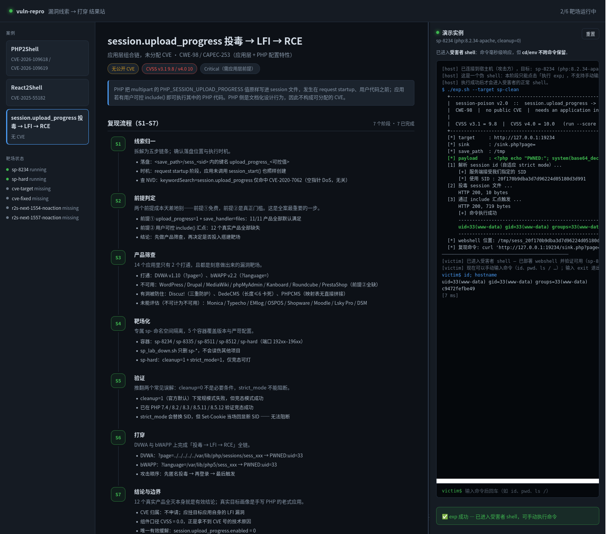
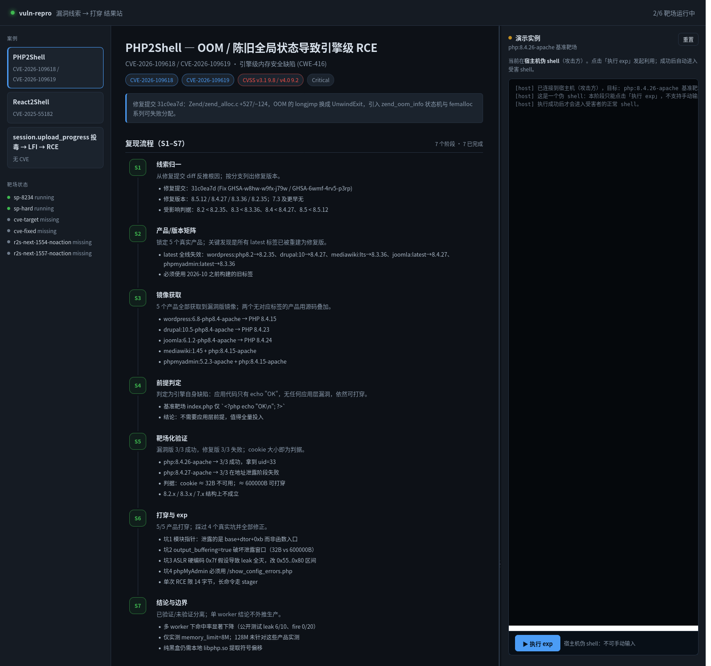

# vuln-repro-agent

[](https://github.com/svengong/vuln-repro-agent/actions/workflows/ci.yml)
[](LICENSE)
[](https://www.python.org/)
[](#环境要求)

**从一条 CVE 编号或一句漏洞线索，做到「可点击验证的打穿」——而不是一份看起来很像的 Markdown 报告。**

做**环境检测 → 多产品版本矩阵 → 隔离靶场打穿 → 交互式 shell → 可视化管理台**的完整 agent。
这不是提示词集合，而是把「结果不稳定」的根因固化成**可执行的门禁**。

> 用它复现过：**CVE-2026-109618 / 109619**（PHP 引擎 RCE）、**CVE-2025-55182**（React Server Components 反序列化 RCE），
> 以及一条**没有 CVE** 的 `session.upload_progress` → LFI → RCE 应用层链。
> 每个都带**修复版对照**与**交互式 shell**，并直接落进可视化面板。

### 30 秒看懂它解决什么

| 常见做法 | 本项目 |
|---|---|
| 照着 blog 复现一次，写"可 RCE" | 必须 N/N 成功率 + **修复版 0/N 对照** |
| 只在一个产品上验证 | 强制**多产品版本矩阵**，单产品直接告警 |
| 靶场没起来，脚本报错 → 写成"不可利用" | S0 环境检测，**区分 `unevaluated` 与 `miss`** |
| 结论停在终端里，同事看不到 | 强制写进 dashboard，**点一下就能复跑** |
| 打完给个截图 | 交付**可手动敲命令的交互式 shell** |

---

## 直接可用的提示词（开箱打穿两个真实 CVE）

装好之后，新建一个会话，选预设 **「漏洞复现 (vuln-repro)」**，然后**把下面任意一句原样发过去**即可。
不需要补充任何细节——环境检测、靶场搭建、版本矩阵、修复版对照、交互式 shell、
以及最后写进 dashboard，都由 agent 按 S0–S7 自己完成。

### 提示词 1 · PHP2Shell（CVE-2026-109618 / CVE-2026-109619）

```text
复现 CVE-2026-109618 和 CVE-2026-109619，用隔离 Docker 靶场打穿，拿到交互式 shell，
并更新 dashboard。
```

### 提示词 2 · React2Shell（CVE-2025-55182）

```text
复现 CVE-2025-55182，重点验证不需要 Server Action 的应用能否打穿，
带修复版对照，拿到 shell 后更新 dashboard。
```

### 提示词 3 · 无 CVE 的应用层链（session.upload_progress）

```text
复现 session.upload_progress 投毒 -> LFI -> RCE，验证 cleanup=1 和 strict_mode=1 是否真能阻断，
把结论写进 dashboard。
```

> 只想要面板、不跑漏洞时说一句 `启动面板` 即可，agent 会直接启动 dashboard 并回报案例与靶场状态。

### 打穿后的面板长什么样

右侧「演示实例」从**宿主机伪 shell** 开始（exp 不自动执行），点击「执行 exp」后真实运行利用，
命中后自动解锁**受害者 shell**，可以直接手敲 `id`、`pwd`：



上图是在远端 Ubuntu 22 上实跑的结果：`uid=33(www-data)`、`[7 ms]` 回显、绿色「exp 成功」。
完整的 S1–S7 流程、产品版本矩阵与能力边界都在同一页：



---

## 为什么需要它

同一类工作反复出现同几种失败：

| 失败 | 后果 | 本项目的对策 |
|---|---|---|
| 只测一个产品就下结论 | 结论不成立，但页面看起来"已打穿" | `preflight` / `casefile` 对单产品告警 |
| 没有修复版对照 | 无法区分"漏洞生效"与"本来就通" | 强制 `control-fail` 记录 |
| 靶场没起来 / 端口被占 | 静默失败被当成"不可利用" | S0 环境检测，端口与容器清单 |
| 分不清"没测"与"不成立" | 把"没评估"说成"安全" | `unevaluated` 与 `miss` 严格区分 |
| 打完不入库 | web 端看不到，用户以为没做 | S7 强制 `case merge` 并核对 `status` |
| 清理脚本宽匹配 | 误杀无关进程/容器 | 前缀 + cwd 锚定 |

---

## 快速开始

```bash
git clone https://github.com/svengong/vuln-repro-agent.git
cd vuln-repro-agent

# 一句话启动（无子命令即启动 dashboard；已在跑则复用）
./bin/vulnrepro

# 新机器上案例库可能是空的 —— 这是合法状态，页面照常可用
```

打开 <http://127.0.0.1:3010>。

---

## 命令

| 命令 | 作用 |
|---|---|
| `vulnrepro` / `vulnrepro dashboard` | 启动 dashboard（幂等） |
| `vulnrepro stop` | 停止由本工具启动的 dashboard |
| `vulnrepro preflight` | 环境检测（**开打之前必跑**） |
| `vulnrepro doctor` | 一键体检：环境 + 案例 + dashboard |
| `vulnrepro status` | 当前状态（案例、容器、dashboard） |
| `vulnrepro case scaffold` | 生成案例文件骨架 |
| `vulnrepro case validate [path]` | 校验案例文件 |
| `vulnrepro case merge <file>` | 校验通过后写入 dashboard |

退出码：`0` 成功 / `1` 失败 / `2` 部分可用（有 WARN）。

---

## 环境要求

| 依赖 | 用途 | 缺失时 |
|---|---|---|
| Python 3.10+ | 所有工具链 | 不可用 |
| Node 18+ | dashboard 服务 | 无法启动 dashboard |
| Docker | 靶场容器 | preflight 报 FAIL；只能走本机进程靶场 |
| curl / bash | 探测与脚本 | preflight 报 FAIL |

dashboard 的靶场位置通过 `VULN_REPRO_LABS` 指定（默认取仓库上一级目录）：

```bash
VULN_REPRO_LABS=/path/to/labs ./bin/vulnrepro
```

没有配置靶场时 dashboard 仍可用，案例照常浏览，只是演示面板会提示"未配置可执行靶场"。

---

## 目录结构

```
vuln-repro-agent/
├── bin/
│   ├── vulnrepro       # 统一入口
│   ├── preflight.py    # 环境检测 + 结论质量门禁
│   └── casefile.py     # 案例 schema 校验 / 骨架 / 合并
├── skill/              # agent 的方法论（SKILL.md + reference/ + examples/）
├── dashboard/          # 可视化 + 真实 EXP 演示（Node，零框架依赖）
├── cordis.patch.yml    # DSH agent preset 声明
├── tests/              # 零外部依赖的测试
└── docs/
```

---

## 七阶段工作流

| 阶段 | 做什么 | 完成判据 |
|---|---|---|
| **S0 环境检测** | `vulnrepro preflight` | 无 FAIL；WARN 记入结论 |
| S1 线索归一 | 核对官方来源与修复 diff | ≥2 个独立来源 |
| S2 产品/版本矩阵 | 锁定"组件未修且可获取"的版本 | **≥2 版本，含修复版** |
| S3 镜像获取 | 核实容器内真实版本 | 记录构建时间与内置版本 |
| S4 前提判定 | 组件缺陷 vs 应用层前提 | 分诊结论 |
| S5 靶场验证 | 隔离命名空间 + N 次统计 + 对照 | 漏洞版 N/N，修复版 0/N |
| S6 打穿与 exp | 处理命令槽/ASLR/入口/持久 shell | 能手动敲命令并拿到输出 |
| S7 结案 | 写案例 JSON 并入 dashboard | 页面可见且可演示 |

方法论细节见 [skill/SKILL.md](skill/SKILL.md)。

---

## 作为 DSH agent 使用

本仓库同时是一个 DeepSeek Harness agent preset bundle：

```bash
# 在 DSH 中安装该 bundle 后，新建会话选择「漏洞复现 (vuln-repro)」
```

preset 的 persona 会把 S0–S7 与三条硬判据写进系统提示，
所以即使不说细节，行为也保持一致：

- "启动 dashboard" → 直接启动，不追问
- 单产品/无对照 → 主动补测或明确标注为"疑似"
- 跑完 → 必须 `case merge` 并核对 `status`

---

## 安全边界

- 只绑定 `127.0.0.1`
- demo 可执行的命令在服务端**白名单**写死，客户端只能传目标 key
- 案例文件不接受任意命令；`targetKey` 必须已在 `TARGETS` 中定义
- 仅用于**授权的隔离环境**（本地 Docker / 明确授权的测试范围）
- 靶场命名空间带专属前缀，清理只删自己的资源

---

## 测试

```bash
python3 tests/run_tests.py
```

覆盖门禁行为（单产品告警、无对照告警、非法枚举拒绝、schema 校验）
与 CLI 可用性，不依赖 Docker。

---

## License

MIT
